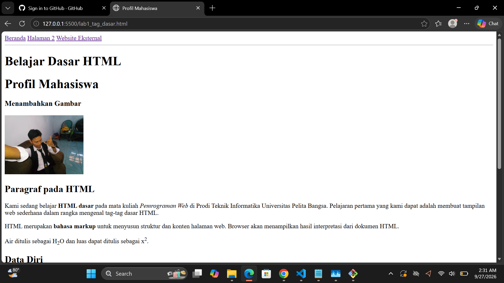
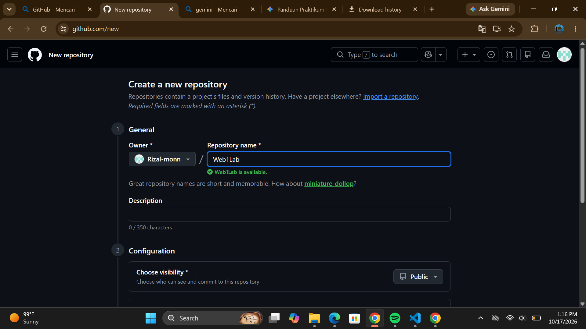
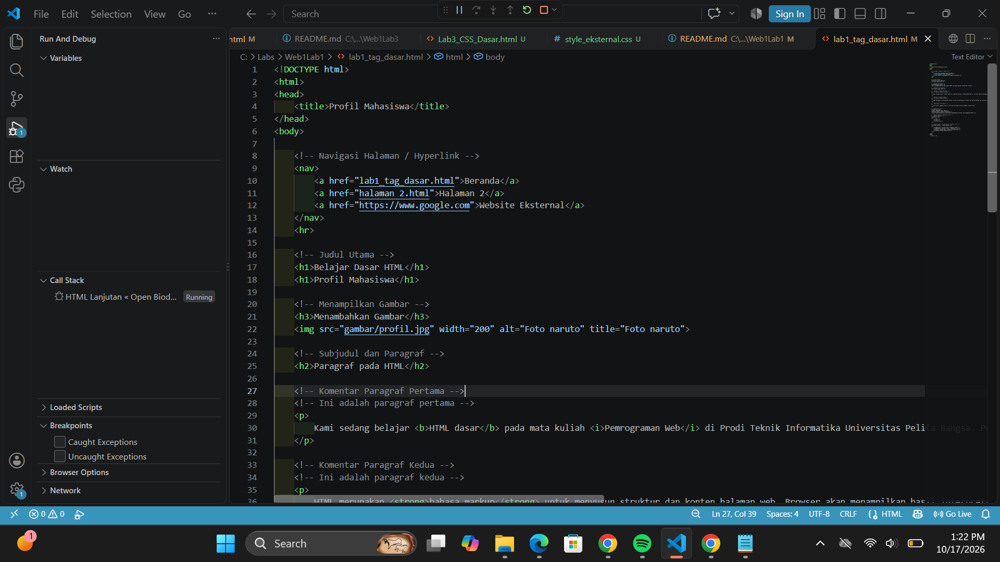
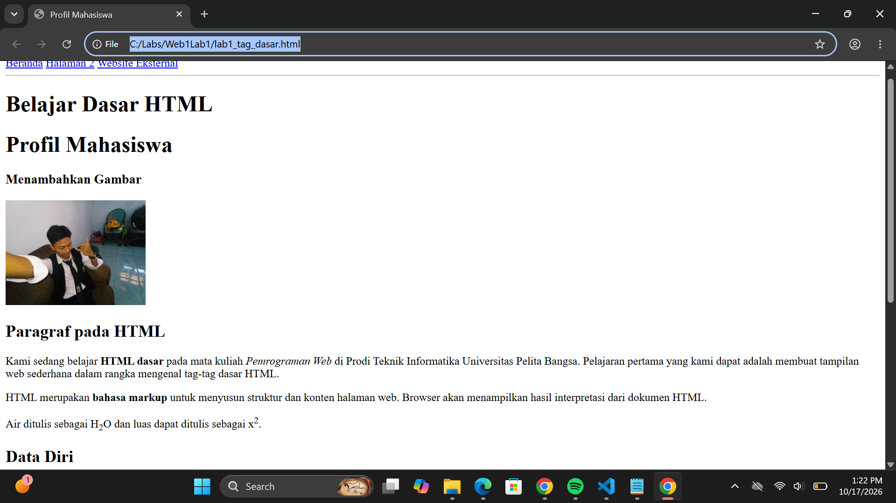
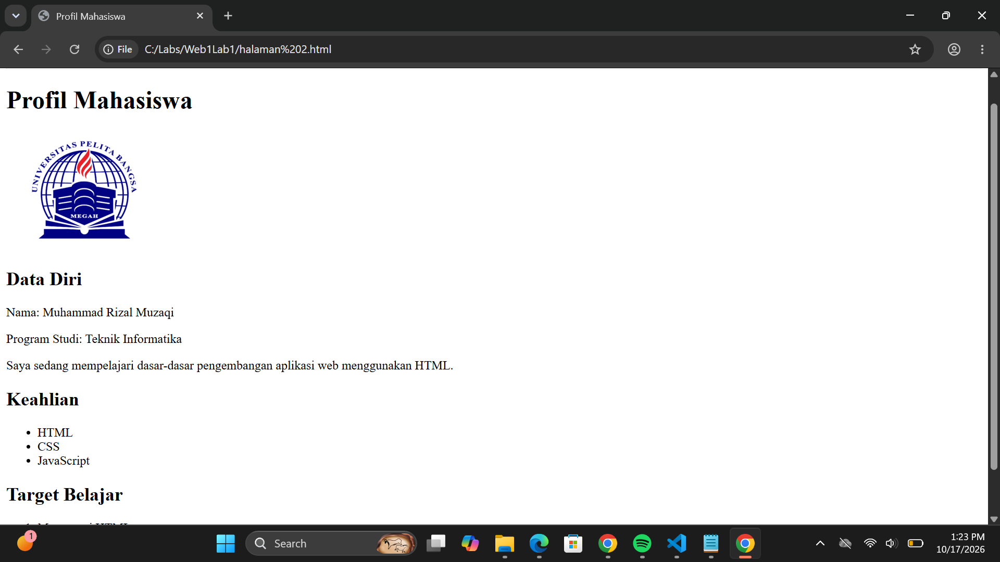
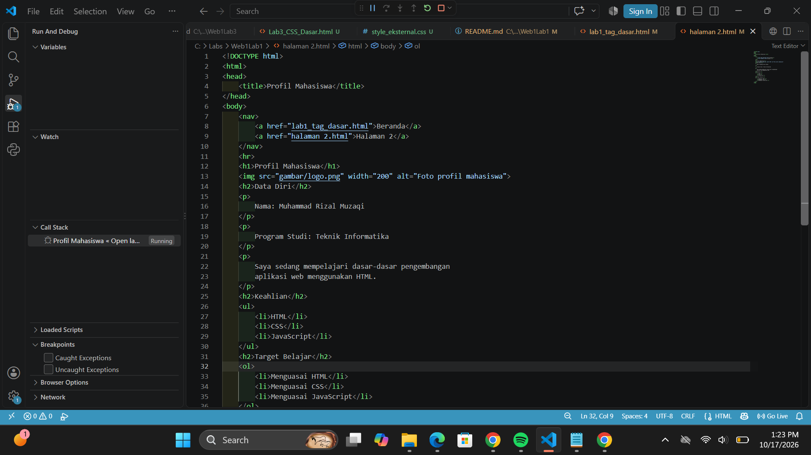
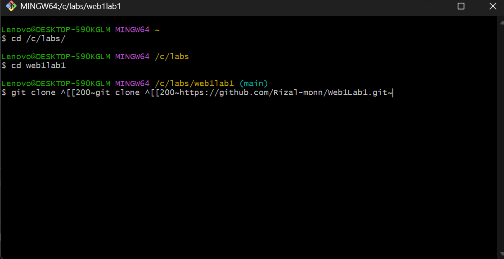
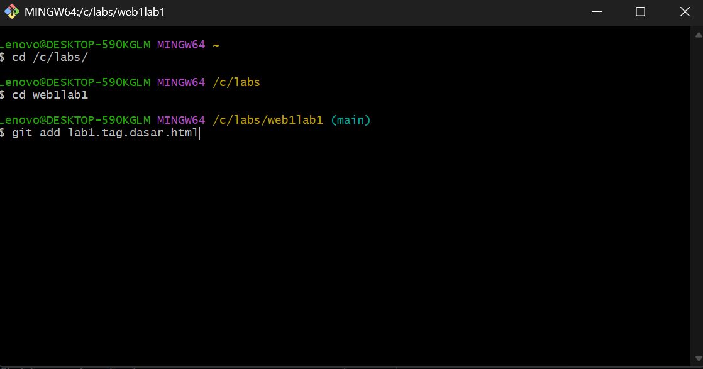
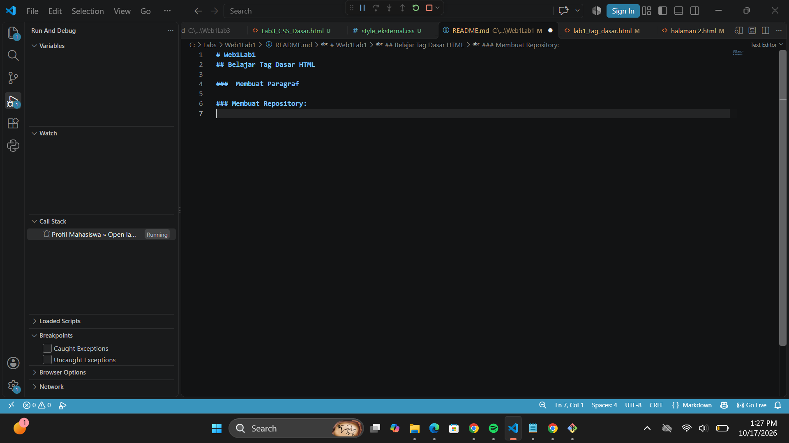

# Lab1Web - Praktikum 1 HTML Dasar

Repository ini berisi hasil pengerjaan **Praktikum 1: HTML Dasar** dari mata kuliah Pemrograman Web. Praktikum ini bertujuan untuk memahami struktur dasar dokumen HTML, penggunaan tag, elemen, atribut, dan pembuatan dokumen web sederhana.

### Daftar gambar :










## Penjelasan Langkah Praktikum

Berikut adalah penjelasan singkat dari setiap langkah yang dilakukan selama praktikum:

### 1. Struktur Dasar HTML dan Paragraf
Membuat file `index.html` yang berisi struktur utama HTML (`<!DOCTYPE html>`, `<html>`, `<head>`, `<body>`). Kemudian menambahkan elemen paragraf menggunakan tag `<p>` untuk menampilkan blok teks.


### 2. Menambahkan Judul (Heading)
Menggunakan tag `<h1>` untuk judul utama dan `<h2>` untuk subjudul agar teks lebih besar, tebal, dan terstruktur.


### 3. Memformat Teks
Menerapkan tag format teks pada paragraf seperti `<b>` untuk tebal, `<i>` untuk miring, `<sub>` untuk teks ke bawah (seperti H₂O), dan `<sup>` untuk teks ke atas (pangkat).


### 4 & 5. Menyisipkan dan Mengatur Ukuran Gambar
Menampilkan gambar ke dalam web menggunakan tag ``. Atribut `src` digunakan untuk memanggil lokasi gambar di folder `images/`, sedangkan atribut `width` digunakan untuk mengatur lebar gambar.


### 6. Menambahkan Hyperlink
Membuat navigasi menggunakan tag `<a>` dengan atribut `href`. Terdapat link internal untuk berpindah antar halaman (ke `halaman2.html`) dan link eksternal (ke web lain seperti Google).


### 7. Menambahkan List (Daftar)
Membuat daftar keahlian menggunakan *Unordered List* `<ul>` (daftar berupa simbol titik/bullet) dan *Ordered List* `<ol>` (daftar berurutan dengan angka) dipadukan dengan tag `<li>` untuk isi daftarnya.


### 8. Menambahkan Komentar
Menyisipkan tag komentar `<!-- ... -->` di dalam kode HTML. Komentar ini berguna sebagai catatan bagi pembuat kode dan tidak akan dimunculkan saat halaman web dibuka.


### 9. Menggabungkan Semua Elemen (Halaman Profil Mahasiswa)
Menggabungkan semua materi (Heading, paragraf, gambar, hyperlink, dan list) ke dalam satu file HTML yang utuh untuk membuat halaman "Profil Mahasiswa" sederhana.


---

## Jawaban Pertanyaan Modul

**1. Apa fungsi deklarasi `<!DOCTYPE html>` pada dokumen HTML?**
Fungsinya adalah untuk memberi tahu browser bahwa dokumen tersebut menggunakan standar HTML versi ke-5 (HTML5).

**2. Apa perbedaan antara tag, elemen, dan atribut pada HTML?**
- **Tag**: Tanda kurung siku pembuka dan penutup (`<...>` dan `</...>`) untuk menandai bagian kode.
- **Isi/Elemen**: Kesatuan utuh yang terdiri dari tag pembuka, isi/konten, dan tag penutup (misal: `<p>Ini teks</p>`).
- **Atribut**: Informasi tambahan yang disisipkan di dalam tag pembuka (misal: `href="..."` pada tag `<a>`).

**3. Apa perbedaan `<p>` dengan `<br>`? Jelaskan penggunaannya.**
- `<p>` digunakan untuk membuat sebuah **paragraf** baru, biasanya akan otomatis memberikan jarak spasi kosong dengan blok teks di atas atau di bawahnya.
- `<br>` digunakan hanya untuk **pindah baris** (seperti menekan tombol Enter) tanpa membuat paragraf baru atau jarak ekstra.

**4. Apa fungsi atribut `href` pada tag `<a>`?**
Berfungsi untuk menentukan alamat tujuan (URL) dari sebuah link, sehingga saat teks diklik, browser tahu ke mana harus berpindah halaman.

**5. Apa perbedaan hyperlink ke halaman internal dengan hyperlink ke website eksternal?**
- **Internal**: Link mengarah ke file atau halaman lain di dalam website/folder proyek yang sama (contoh: `href="halaman2.html"`).
- **Eksternal**: Link mengarah ke website lain di internet secara penuh (contoh: `href="https://google.com"`).

**6. Apa fungsi atribut `src` dan `alt` pada tag ``?**
- `src` (source): Menentukan lokasi atau alamat di mana file gambar itu disimpan.
- `alt` (alternative text): Menyediakan teks deskripsi pengganti yang akan muncul jika gambar gagal dimuat, serta membantu pembaca layar (screen reader) bagi penyandang disabilitas.

**7. Apa perbedaan penggunaan `<ul>` dan `<ol>`?**
- `<ul>` (Unordered List): Membuat daftar yang tidak berurutan, ditandai dengan simbol seperti titik (bullet).
- `<ol>` (Ordered List): Membuat daftar yang berurutan, ditandai dengan angka atau huruf (1, 2, 3 atau A, B, C).

**8. Apa yang terjadi jika path gambar pada atribut `src` salah?**
Gambar tidak akan muncul di halaman web (terlihat ikon gambar rusak atau kosong), dan jika terdapat atribut `alt`, teks pada `alt` tersebutlah yang akan ditampilkan menggantikan gambar.

**9. Mengapa struktur heading h1 sampai h6 perlu digunakan secara terstruktur?**
Untuk menjaga hierarki informasi dan mempermudah mesin pencari (SEO) serta pembaca dalam memahami konteks konten. Judul utama memakai `<h1>`, subjudul memakai `<h2>`, dan seterusnya secara berurutan agar rapi dan logis.

**10. Apa fungsi komentar `<!-- ... -->` dalam kode HTML?**
Berfungsi sebagai catatan bagi penulis kode (programmer) untuk memberi keterangan. Kode di dalam komentar akan diabaikan oleh browser dan tidak akan terlihat di halaman web.
```eof

