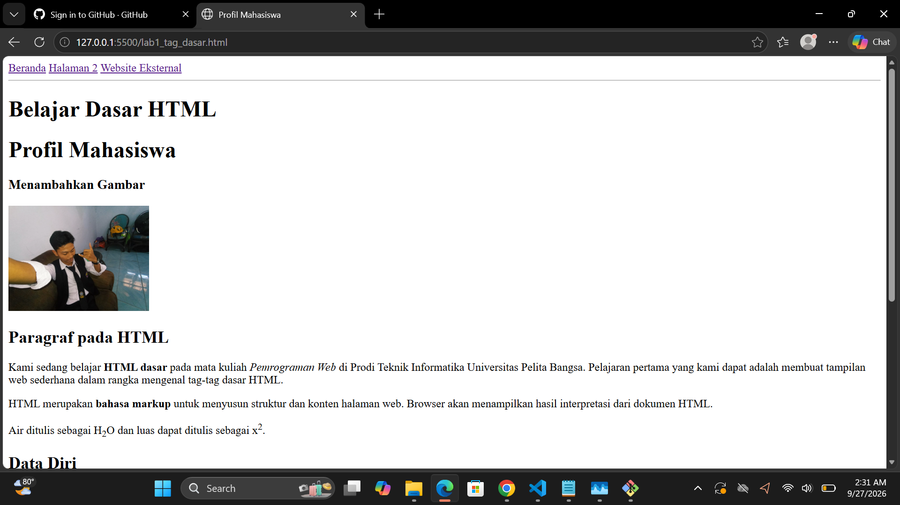

# Web1Lab1
## Belajar Tag Dasar HTML

###  Membuat Paragraf

### Membuat Repository:

1. Apa fungsi deklarasi <-!DOCTYPE html> pada dokumen HTML?
Jawaban:
Deklarasi <-!DOCTYPE html> berfungsi untuk menyatakan kepada browser bahwa dokumen tersebut menggunakan standar HTML5. Deklarasi ini diletakkan pada bagian paling awal dokumen agar browser dapat merender halaman web dengan benar dan sesuai standar.   